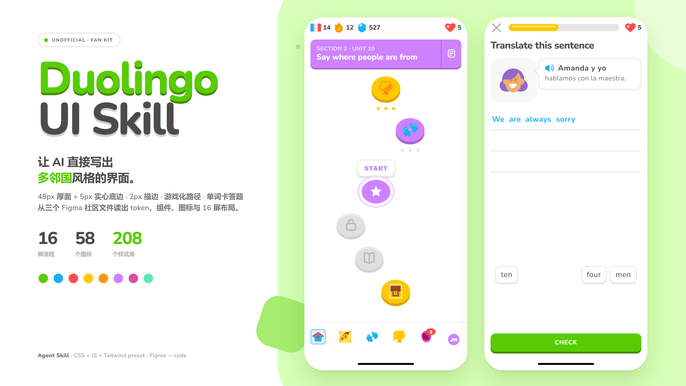
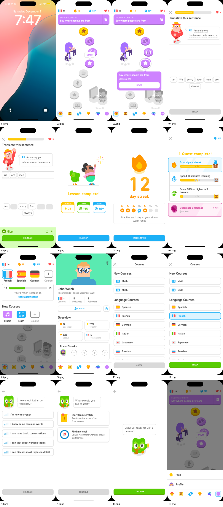

<p align="right"><a href="README.md">简体中文</a> | English</p>

# duolingo-ui

An Agent Skill that lets coding agents build interfaces in the visual language of **Duolingo**. Web first: HTML, CSS, Tailwind, React and Vue prototypes.

It does not clone Duolingo's product. It breaks the visual grammar of three Figma Community files into tokens, components and layouts an agent can assemble: 48px faces with 5px solid edges, 2px outlines, rounded type, saturated colours, a winding lesson path, word-bank exercises, and the streak / gem / heart / chest gamification layer.



## Install

**Any agent (after the repo is published)** — with the [skills](https://github.com/vercel-labs/skills) CLI. It detects 50+ agents, including Claude Code, Codex, OpenCode, Cursor, Gemini CLI and GitHub Copilot.

```bash
npx skills add zhpencil/duolingo-ui-skill
```

```bash
# specific agents only, installed globally (-g)
npx skills add zhpencil/duolingo-ui-skill -g -a claude-code -a codex -a opencode
```

**Claude Code plugin marketplace**

```bash
/plugin marketplace add zhpencil/duolingo-ui-skill
/plugin install duolingo-ui@duolingo-ui-skill
```

**Manual / local** — copy the folder into your agent's skills directory as `duolingo-ui`.

```bash
git clone https://github.com/zhpencil/duolingo-ui-skill ~/.claude/skills/duolingo-ui
```

| Agent | Global | Project |
|---|---|---|
| Claude Code | `~/.claude/skills/` | `.claude/skills/` |
| Codex | `~/.codex/skills/` | `.agents/skills/` |
| OpenCode | `~/.config/opencode/skills/` | `.agents/skills/` or `.opencode/skills/` |
| Cursor | `~/.cursor/skills/` | `.agents/skills/` |
| Gemini CLI | `~/.gemini/skills/` | `.agents/skills/` |

## Usage

Ask in plain language and the agent loads the skill:

- "Build a Duolingo-style language-learning home screen with streak, gems, hearts and a winding path."
- "Turn this flashcard page into Duolingo's exercise UI: three answer lines, a bottom CHECK, and a green result panel that rises after a correct answer."
- "Make a leaderboard page with Tailwind; medals for the top three and a pale blue row for the current user."
- "Restyle this settings page in the Duolingo look, but keep our fields."

To see the kit first, serve the repo and open the demo:

```bash
python -m http.server 8765
# http://127.0.0.1:8765/assets/demo.html
```

## What's inside

| Path | Contents |
|---|---|
| `SKILL.md` | The agent entry point: workflow, 20 aesthetic rules, token cheat sheet, component inventory, 16-screen map, Figma pitfalls, self-check list |
| `assets/duolingo.css` | ~1,800 lines. Every `--duo-*` token plus 208 `.duo-*` selectors (components, variants and showcase helpers) |
| `assets/duolingo.js` | 20 KB dependency-free behaviour layer: word bank, sheets, dialogs, toasts, progress, rings, switches, checks, sliders, keyboard press states, focus trap |
| `assets/tokens.json` | W3C DTCG tokens with the original Figma names |
| `assets/tailwind.preset.js` | Tailwind v3 preset under the `duo` namespace: `bg-duo-feather-500`, `rounded-duo-lg`, `shadow-duo-btn-green` |
| `assets/demo.html` | Full showcase: palette, type, buttons, progress, 58 icons, component wall, and four interactive phones |
| `assets/icons-sprite.svg` | 58 `<symbol>`s, `di-*`. Inline it at the top of `<body>` |
| `assets/icons/` | 55 standalone SVGs; the other 3 multicolour nav icons live only in the sprite |
| `assets/fonts/nunito-latin.woff2` | Variable stand-in, registered as `Duo Rounded`, weights 200–900; licence in `assets/fonts/OFL.txt` |
| `assets/brand/` | Wordmark and UNOFFICIAL badge for documentation only; never use them in a product |
| `references/tokens.md` | Colour, type, radius, border, solid edge, dimension, spacing and motion tables, with usage notes and derivations |
| `references/components.md` | Every component's HTML structure, exact dimensions, states, behaviour, accessibility and pitfalls |
| `references/layouts.md` | Wireframes and assembly notes for the 16 Figma screens and the four demo phones |
| `references/motion.md` | Press, sheet, dialog, toast, progress and celebration choreography |
| `references/inventory.md` | Figma file / node → component → CSS class → screenshot mapping, plus uncovered gaps |
| `references/screenshots/flows/` | 16 Figma exports at 430×932, one per flow screen |
| `tools/render.py` | Playwright + Edge screenshot harness with the Windows path preconfigured |
| `tools/figma_dump.py` | Flattens Figma MCP `get_file` output into a node → size → fill → text list |
| `tools/capture-phones.py` | Recreates the cover and demo phone captures |

## The grammar in eight rules

1. **Controls are slabs, not floating cards.** Primary button: 48px face + 5px solid edge, radius 13. Pressing sinks it 5px and removes the edge in 60ms. No gradients, ripples or hover scaling. Small 38+3, large 52+5.
2. **2px is the basic stroke.** Cards, word tiles, inputs, course rows and progress tracks use 2px `#e5e5e5`; only the bottom-nav top edge and a few dividers use 1px.
3. **Type is round, heavy and tight.** Heading 26/800 at `-0.52px`; button 16/800 uppercase at `+0.8px`; 20px body at `+0.6px`. Body is 16–20px in `#4b4b4b`. Do not set everything to 800.
4. **Saturated colour, strict meaning.** Green `#58cc02` (edge `#478700`) means correct / primary action / progress. Blue `#1cb0f6` (edge `#1899d6`) means tappable info / selected. Red `#ff4b4b` (edge `#e53b3b`) is hearts, errors and danger only. Yellow `#ffc800` is XP, streaks and chests; purple `#ce82ff` is the path section colour; mint `#5aeab1` is the profile hero. One green primary action per screen.
5. **The path is a winding bead necklace.** Nodes are 76×70 with a 7px dark-purple edge. The current node gets a 7px white ring and an 11px lilac ring. Completed nodes are gold, locked ones grey. Each row shifts with `--duo-path-x`; row gap 18px, side padding 24px.
6. **Exercises speak at the top and assemble at the bottom.** Answer line 56px high with a 2px underline; word tiles 46px high, 20/400, 2px border + 2px edge. A placed word leaves an invisible slot in the bank and appears as 20px bold blue text. Bottom CHECK is 48+5 and full width.
7. **A correct answer is a full-width green panel, not a toast.** It rises from the bottom, pale green, with CONTINUE underneath. Toasts are for lightweight confirmations and dismiss after 2.4s.
8. **The bottom nav is 94px tall and has no labels.** Five 40×40 targets with 32px icons. Selection is a 40×40 pale-blue rounded block with a 2px blue inner stroke, not just a colour change.

Full values and derivations are in `references/tokens.md`; the reasoning and the cases where you may deviate are in `SKILL.md`.

## 16 screens and four phones

`references/screenshots/flows/01.png`–`16.png` are 1:1 Figma exports of the full flow: lock screen, lesson path, START tooltip, exercise, answered exercise, lesson complete, streak, quest complete, course picker, own profile, course list, selected course, proficiency survey, starting point, intro, and the feed/profile bottom menu.

<a href="references/screenshots/flows-contact.png"></a>

The four phones in `assets/demo.html` are live: the lesson path, the word-bank exercise (place and remove words, CHECK enables, success toast), the profile, and an overlay lab (course list, bottom sheet, quit dialog, scrim, focus trap, Esc).

## Where this differs from Figma

These are deliberate, not bugs:

- **The font is substituted.** The source uses DIN 2014 Rounded VF, a commercial face. This skill ships Nunito (SIL OFL) and keeps `DIN Next Rounded`, `din-round` and `Duo Rounded` in the stack. Nunito is slightly narrower and taller, so **line breaks and text widths will not match Figma pixel for pixel**; control sizes, colours and spacing do. Do not bundle the commercial DIN font.
- **Placed words have two renderings.** File 1's static screens show them as white chips; the live app uses blue text. The default follows the live app. Add `.duo-answer-line--chips` to recreate File 1's static look.
- **Four controls are derived.** `.duo-switch`, `.duo-input`, `.duo-slider` and `.duo-empty` have no standalone component in the sources; they are built from the same tokens and marked "derived" in `references/components.md`.
- **No dark mode.** None of the three sources has one. If a product needs it, label it as derived and keep the 2px outline and solid-edge logic.
- **No official illustration.** The repo contains no Duolingo owl artwork or official wordmark; the demo mascot is a simplified geometric face used as a placeholder. `assets/brand/` is documentation-only.
- **The three files disagree.** File 1 wins for colour, radius and buttons; File 2 for leaderboard, shop, badges and profile extensions; File 3 for web typography and documentation layout.

## Verification

The UI was rendered and checked with Playwright + Microsoft Edge at 430×932: all four phones, word placement/removal, CHECK enablement, toast, sheet/dialog open and close, and the focus trap were exercised. The 16 flow screenshots were compared side by side with the demo. Reproduce:

```bash
python tools/render.py http://127.0.0.1:8765/assets/demo.html full.png --full
python tools/render.py http://127.0.0.1:8765/assets/demo.html phone.png --selector ".duo-phone"
python tools/capture-phones.py http://127.0.0.1:8765/assets/demo.html docs/phones
```

There is **no physical-device calibration**. The screenshots are Figma exports and browser renders, not phone captures; "pixel-perfect" applies to control dimensions and colour only. The only console error in the demo is a favicon 404 (no favicon is shipped).

## Credits and licence

- Design sources:
  - [DuoLingo Design System (Community)](https://www.figma.com/community/file/1460744749282136015/duolingo-design-system) by John Welch, file key `Y9HNcdPRyk3mrVUAzHgldI`.
  - [Duolingo FREE UI Kit - By Marvilo](https://www.figma.com/community/file/1377326303556981356/duolingo-free-ui-kit-by-marvilo) by Marvilo, file key `woBGZQ1U4cS2myXqPfmrzw`.
  - [Duolingo - Unofficial Design Language](https://www.figma.com/community/file/1439600081437366863/duolingo-unofficial-design-language), file key `tUtC9p62GJq20mE82XXdz3`.
- All three files are published under [CC BY 4.0](https://creativecommons.org/licenses/by/4.0/). The icons, component renders, reference screenshots and derived design values remain CC BY 4.0; keep the attribution when redistributing.
- The code and documentation written for this repo are [MIT](LICENSE).
- [Nunito](https://github.com/googlefonts/nunito) is licensed under SIL OFL 1.1; the full text is in `assets/fonts/OFL.txt`.
- Duolingo, the owl and the Duolingo wordmark are trademarks or copyrighted works of their owner. This is an unofficial fan project with no affiliation, sponsorship or endorsement. Do not use the assets in `assets/brand/` or the mascot as a product logo, and do not imply an official connection.
