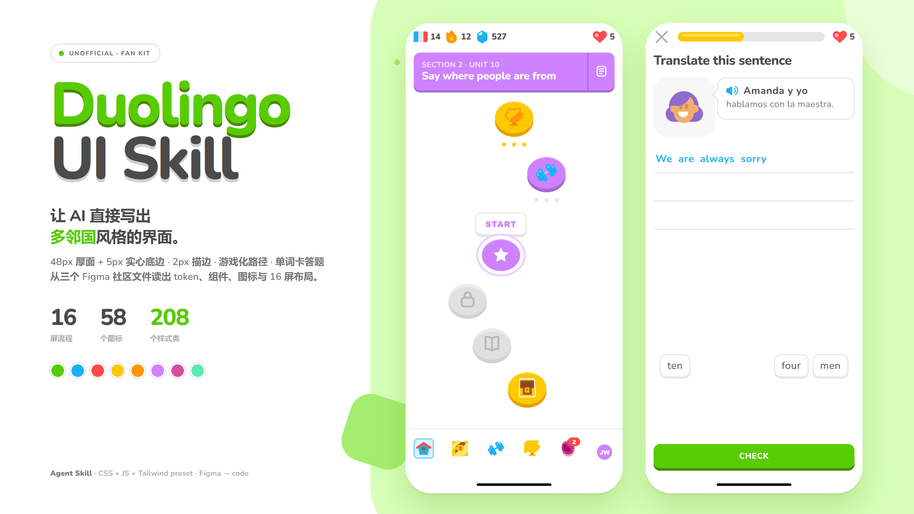
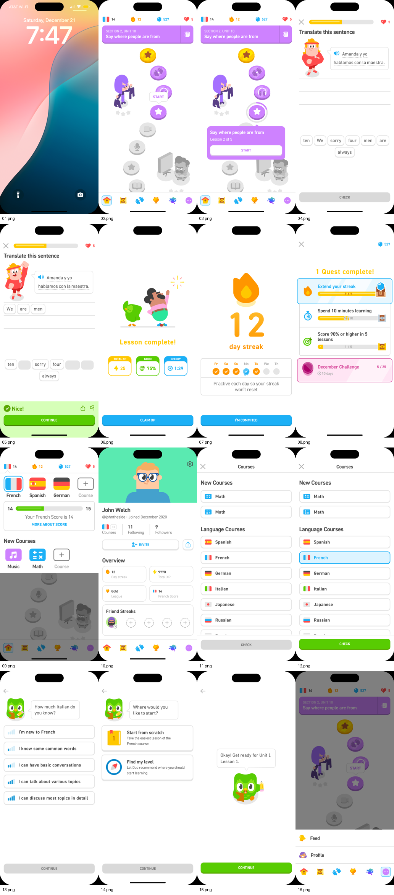

<p align="right">简体中文 | <a href="README.en.md">English</a></p>

# duolingo-ui

让 AI 编程助手直接写出 **Duolingo（多邻国）** 风格界面的 Agent Skill。网页优先，HTML / CSS / Tailwind / React / Vue 原型都能用。

它不复刻 Duolingo 的产品，而是把三个 Figma 社区文件里的视觉语法拆成可以直接组装的 token、组件和布局：48px 厚面 + 5px 实心底边的 3D 按钮、2px 描边、圆润字体、高饱和色、蜿蜒学习路径、单词卡答题，以及连胜 / 宝石 / 红心 / 宝箱这一整套游戏化语言。



## 安装

**通用方式（发布到 GitHub 之后）**：用 [skills](https://github.com/vercel-labs/skills) CLI，它会自动识别你装了哪些 agent，支持 Claude Code、Codex、OpenCode、Cursor、Gemini CLI、GitHub Copilot 等 50 多种。

```bash
npx skills add zhpencil/duolingo-ui-skill
```

```bash
# 只装给指定的 agent，并装到全局（-g）
npx skills add zhpencil/duolingo-ui-skill -g -a claude-code -a codex -a opencode
```

**Claude Code 插件市场**：

```bash
/plugin marketplace add zhpencil/duolingo-ui-skill
/plugin install duolingo-ui@duolingo-ui-skill
```

**手动 / 本地（仓库还没发布时用这个）**：把整个目录放进 agent 的 skills 目录，文件夹名用 `duolingo-ui`。

```bash
git clone https://github.com/zhpencil/duolingo-ui-skill ~/.claude/skills/duolingo-ui
```

| Agent | 全局目录 | 项目目录 |
|---|---|---|
| Claude Code | `~/.claude/skills/` | `.claude/skills/` |
| Codex | `~/.codex/skills/` | `.agents/skills/` |
| OpenCode | `~/.config/opencode/skills/` | `.agents/skills/` 或 `.opencode/skills/` |
| Cursor | `~/.cursor/skills/` | `.agents/skills/` |
| Gemini CLI | `~/.gemini/skills/` | `.agents/skills/` |

## 使用

装好后直接提需求，agent 会自己加载这个 skill：

- 「做一个多邻国风格的语言学习首页，要有连胜、宝石、红心和蜿蜒的学习路径。」
- 「把这个单词卡页面改成 Duolingo 的答题界面：三条答题线、底部 CHECK、答对后从底部升起绿色结果面板。」
- 「用 Tailwind 做一个排行榜页，前三名有奖牌，自己那一行淡蓝底。」
- 「把这个设置页改成多邻国的风格，但保留我们自己的字段。」

想先看效果，在仓库根目录起一个静态服务器：

```bash
python -m http.server 8765
# http://127.0.0.1:8765/assets/demo.html
```

## 包含什么

| 路径 | 内容 |
|---|---|
| `SKILL.md` | 给 agent 的主入口：工作流程、20 条美学规则、token 速查、组件清单、16 屏地图、Figma 原稿里的坑、自检清单 |
| `assets/duolingo.css` | 约 1 800 行。全部 `--duo-*` token + 208 个 `.duo-*` 选择器（组件、变体与展示辅助类）。做网页时优先直接引这一份 |
| `assets/duolingo.js` | 20 KB 无依赖行为层：单词卡上屏 / 退回、底部弹层、对话框、Toast、进度条 / 圆环、开关、勾选、滑块、键盘按压态、焦点陷阱 |
| `assets/tokens.json` | W3C DTCG 格式，保留 Figma 的命名，方便生成别的平台 |
| `assets/tailwind.preset.js` | Tailwind v3 preset，全部挂在 `duo` 命名空间：`bg-duo-feather-500`、`rounded-duo-lg`、`shadow-duo-btn-green` |
| `assets/demo.html` | 完整展示页：色板、字号、按钮、进度、58 个图标、组件墙，以及 4 台能实际操作手机 |
| `assets/icons-sprite.svg` | 58 个 `<symbol>`，`di-*`。内联到 `<body>` 开头即可用 |
| `assets/icons/` | 55 个独立 SVG（另外 3 个多色底栏图标只存在于 sprite） |
| `assets/fonts/nunito-latin.woff2` | 变量字体替身，`@font-face` 名是 `Duo Rounded`，字重 200–900；许可见 `assets/fonts/OFL.txt` |
| `assets/brand/` | 说明页备用的字标和 UNOFFICIAL 徽标（cover 的标题是 HTML 文字）。**不要**用在产品里 |
| `references/tokens.md` | 颜色 / 字体 / 圆角 / 描边 / 实心底边 / 尺寸 / 间距 / 动效全表，每条注明用途和推导公式 |
| `references/components.md` | 每个组件的 HTML 结构、精确尺寸、全部状态、交互、可访问性和常见错误 |
| `references/layouts.md` | 16 个 Figma 流程界面 + 4 台 demo 手机的逐屏拆解：线框、间距、用了哪些类、怎么组装 |
| `references/motion.md` | 按压、弹层、对话框、Toast、进度、庆祝动效的时长、曲线和编排 |
| `references/inventory.md` | 三个 Figma 文件的页面 / 节点 → 组件 → CSS 类 → 截图 → 素材对照表，以及没覆盖到的部分 |
| `references/screenshots/flows/` | 16 张 430×932 的 Figma 原始界面导出，按流程编号 |
| `tools/render.py` | Playwright + Edge 截图脚本，Windows 默认路径已配好 |
| `tools/figma_dump.py` | 把 Figma MCP 的 `get_file` 输出压成「节点 → 尺寸 → 填充 → 文字」清单 |
| `tools/capture-phones.py` | 复现 cover 和 demo 手机截图的小脚本 |

## 设计语法速览

真正让界面“像 Duolingo”的是下面这些约束，不是猫头鹰：

1. **控件是厚块，不是浮起来的卡片。** 主按钮 48px 面 + 5px 实心底边，圆角 13；按下时整体下沉 5px、底边归零，60ms 完成。没有渐变、没有 ripple、没有 hover 放大。小按钮 38 + 3，大按钮 52 + 5。
2. **2px 是基本笔画。** 卡片、词卡、输入框、课程行、进度条外框都用 2px `#e5e5e5`；只有底部导航顶边和少数分隔线是 1px。不要用 1px 发丝线做主轮廓。
3. **字体圆、重、紧。** 标题 26/800、字距 `-0.52px`；按钮 16/800 大写、`+0.8px`；20px 正文 `+0.6px`；正文 16–20px，`#4b4b4b`。大字号收紧、小字号放松，不要把全部文字都设成 800。
4. **颜色饱和，但用途严格。** 绿 `#58cc02`（底边 `#478700`）只表示正确 / 主行动 / 学习进度；蓝 `#1cb0f6`（底边 `#1899d6`）表示可点的信息 / 选中；红 `#ff4b4b`（底边 `#e53b3b`）只给红心、错误、危险；金黄 `#ffc800` 给 XP / 连胜 / 宝箱；紫 `#ce82ff` 是路径章节色；薄荷 `#5aeab1` 是资料页头部。一屏只允许一个绿色主行动。
5. **学习路径是蜿蜒的珠子项链。** 节点 76×70，紫色面 + 7px 深紫底边；当前节点外有 7px 白环 + 11px 淡紫环；已完成金色、未解锁灰色。每行用 `--duo-path-x` 左右错开，行距 18px，左右内边距 24px。
6. **答题是“上面说话、下面拼词”。** 答题行 56px 高、2px 底边；词卡 46px 高、20/400、2px 描边 + 2px 底边；上屏后词池原词留空槽，答题行是蓝色 20px 粗体文字；底部 CHECK 通栏 48 + 5。
7. **答对反馈是整宽绿色面板，不是 Toast。** 从底部升起，淡绿底，下面是 CONTINUE；Toast 只用于“已保存”这类轻提示，2.4s 自动消失。
8. **底部导航 94px，没有文字。** 5 个 40×40 点击区、32px 图标；选中不是换色，而是套一个 40×40 淡蓝圆角块 + 2px 淡蓝描边。

完整数值和推导见 `references/tokens.md`；为什么这么定、什么情况下可以偏离，见 `SKILL.md` 的「美学要点」。

## 16 屏与 4 台手机

`references/screenshots/flows/01.png`–`16.png` 是三个 Figma 文件里 16 个完整流程界面的 1:1 导出。它们覆盖：锁屏、学习路径、START 气泡、答题、已拼好、课程完成、连胜、任务完成、课程选择器、自己的资料、课程列表、已选课程、熟练度问卷、起点选择、引导语、底部菜单。

<a href="references/screenshots/flows-contact.png"></a>

`assets/demo.html` 里的四台手机是活的，可以直接点：

- **学习路径**：顶栏计数、紫色章节头、6 个节点、宝箱、底部导航。
- **单词答题**：点词上屏、点已上屏的词退回、CHECK 随词数启用、点 CHECK 出成功 Toast。
- **个人资料**：薄荷头部、头像压边、三栏统计、Overview 2×2、Friend Streaks。
- **浮层实验室**：课程列表 + 底部弹层 + 退出对话框；都有遮罩、焦点陷阱和 Esc 关闭。

## 和 Figma 原稿的差异

这些差异是故意的，不要当成 bug：

- **字体换了。** 原稿是 DIN 2014 Rounded VF（商业授权），本 skill 用 Nunito（SIL OFL）替代，字体栈里保留 `DIN Next Rounded`、`din-round` 和 `Duo Rounded`。Nunito 的字面略窄、略高，所以**文字宽度和换行不会与 Figma 像素级一致**；控件尺寸、颜色和间距是一致的。不要把商业 DIN 字体打包进你的仓库。
- **已选单词有两种画法。** File 1 的静态稿把上屏单词画成白色 chip；真实 App 是蓝色文字。CSS 默认跟随真实 App（蓝色文字），要复刻 File 1 的静态稿时给答题行加 `.duo-answer-line--chips`。
- **四个控件是推导的。** `.duo-switch`、`.duo-input`、`.duo-slider`、`.duo-empty` 原稿里没有独立组件，按同一套 token 补的，尺寸和状态在 `references/components.md` 里标注了「derived」。
- **没有暗色模式。** 三个原稿都没有暗色版；如果产品必须暗色，请明确标注为推导，并保持同样的 2px 描边和实心底边逻辑。
- **没有官方插画。** 仓库里没有 Duolingo 的猫头鹰插画或官方字标；demo 里的吉祥物是简化的几何脸，只用于占位。`assets/brand/` 只用于说明页。
- **三个文件会互相矛盾。** 颜色、圆角、按钮以 File 1 为准；排行榜 / 商店 / 徽章 / 资料页的扩展布局以 File 2 为准；Web 字体与展示页排版以 File 3 为准。

## 验证

仓库里的界面用 Playwright + Microsoft Edge 在 430×932 渲染校对过：四台手机、单词上屏 / 退回、CHECK 启用、Toast、弹层 / 对话框开关、焦点陷阱都实际点过；`references/screenshots/flows/` 逐屏和 demo 并排看过。复现：

```bash
python tools/render.py http://127.0.0.1:8765/assets/demo.html full.png --full
python tools/render.py http://127.0.0.1:8765/assets/demo.html phone.png --selector ".duo-phone"
python tools/capture-phones.py http://127.0.0.1:8765/assets/demo.html docs/phones
```

需要说明的是：**没有在真机上逐像素校对**。截图是 Figma 导出和浏览器渲染，不是手机截屏；`pixel-perfect` 只对控件尺寸和颜色成立。演示页唯一会出现的控制台错误是 favicon 404（没有放 favicon）。

## 致谢与许可

- 设计来源：
  - [DuoLingo Design System (Community)](https://www.figma.com/community/file/1460744749282136015/duolingo-design-system)，作者 John Welch，file key `Y9HNcdPRyk3mrVUAzHgldI`。
  - [Duolingo FREE UI Kit - By Marvilo](https://www.figma.com/community/file/1377326303556981356/duolingo-free-ui-kit-by-marvilo)，作者 Marvilo，file key `woBGZQ1U4cS2myXqPfmrzw`。
  - [Duolingo - Unofficial Design Language](https://www.figma.com/community/file/1439600081437366863/duolingo-unofficial-design-language)，file key `tUtC9p62GJq20mE82XXdz3`。
- 三个文件都按 [CC BY 4.0](https://creativecommons.org/licenses/by/4.0/) 授权。图标、组件渲染图、参考截图和由它们派生的设计数值沿用 CC BY 4.0，转载时请保留署名。
- 本仓库自己写的代码和文档使用 [MIT](LICENSE) 许可。
- 字体 [Nunito](https://github.com/googlefonts/nunito) 使用 SIL Open Font License 1.1，全文见 `assets/fonts/OFL.txt`。
- Duolingo、猫头鹰形象、Duolingo 字标是其权利人的商标 / 版权作品。本项目是**非官方**的粉丝整理，与 Duolingo, Inc. 没有隶属、赞助或背书关系。不要把 `assets/brand/` 里的字标或吉祥物当作产品 Logo，也不要暗示官方合作。
